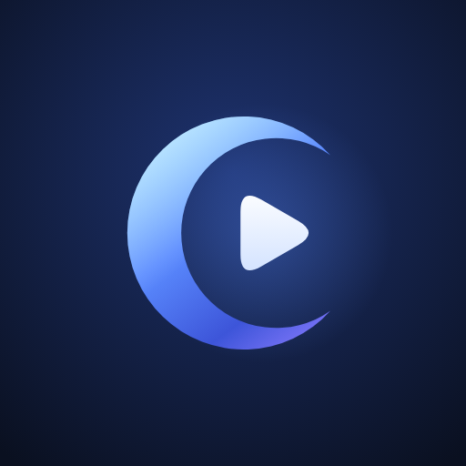

# Mvoon

**Every format, beautifully.** A private, offline-first video and music player for Android, built to grow to iOS and Windows.

 

- **Install (almost every phone):** `dist/Mvoon-1.6.0-arm64-v8a.apk` (signed, Android 8.0+).
- **Any device:** `dist/Mvoon-1.6.0-universal.apk` (arm64, armv7 and x86_64 in one file).
- **Google Play:** `dist/Mvoon-1.6.0.aab` (Play delivers only the parts each phone needs). Source for this release: `dist/Mvoon-1.6.0-source.zip`. How to publish, step by step: [`PUBLISHING.md`](PUBLISHING.md).
- **Licence:** GPL-3.0-or-later ([`LICENSE`](LICENSE)); third-party software and where its source lives: [`THIRD_PARTY_NOTICES.md`](THIRD_PARTY_NOTICES.md); privacy: [`PRIVACY.md`](PRIVACY.md).
- **1.6.0:** a paused video now comes back where it was when you return after a long break (before, Android could release the player in the background and Play did nothing); Mvoon shows as **one card in Recents**; **press and hold** the video for fast playback (slide sideways for 1.5×–4×); **double-tap the middle** to pause or play, with a visible flash; a **round play button** that continues your last video (as in MX Player); **Delete from device** for videos and songs; Home no longer shows *Continue watching* or *New in music*.
- **1.5.1:** the crescent-moon logo (first drawn for Ceruvi) is back as Mvoon's logo; installs over 1.5.0.
- **1.5.0:** renamed to **Mvoon** (store title *Mvoon Player*) with a full-moon logo; package `app.mvoon`.
- **1.4.0:** renamed from *Opalvue* to *Ceruvi* with a new logo; the *Watching / Listening* shelves are now a swipeable carousel; in-app source-code, privacy-policy and licence pages; Play Store listing, graphics and an `.aab`.
- **1.3.0:** the blue palette everywhere (app, logo, launcher icon, splash, generated artwork), *Watching / Listening* shelves of recently played items on Home, and a layout pass so nothing breaks on small screens or with large fonts.
- **1.2.0:** a redesign (notched animated navigation, home dashboard, skeleton loading), every audio track selectable (including ones only VLC can decode), volume up to 200 %, and proper artwork for songs without covers.
- **1.1.0:** the **VLC compatibility engine** for files the phone can't play (WMV, RealMedia, MPEG-2, old DivX…).
- Each version installs over the previous one and keeps your library and history. **Exceptions:** 1.4.0 (`app.ceruvi`) and 1.5.0 (`app.mvoon`) each have a new package name (1.5.1 and 1.6.0 update it normally), so each installs as a separate app; uninstall the older ones (Opalvue, Ceruvi) when you no longer need them.
- **Package:** `app.mvoon`.

---

## 1. Name and brand

**Name:** **Mvoon** — *movie* + *moon*: films and music for the evening. Five letters, a coined word, so it can be owned. Launcher label "Mvoon"; store title "Mvoon Player". Earlier working names: *Opalvue* (1.0–1.3), *Ceruvi* (1.4).

| Check (2026-11-03) | Result |
|---|---|
| `mvoon.com`, `mvoonplayer.com` (Verisign RDAP) | **Not registered** |
| `mvoon.app` (Google Registry RDAP) | **Not registered** |
| Google Play | No app named Mvoon; packages `app.mvoon` / `com.mvoon` unused. Nearest titles: "Moon: Movies, Series & Shows", "Moonboon" |
| GitHub | `github.com/mvoon` free |
| USPTO trademark search (live API) | No MVOON mark. **One close live mark: MVON, class 9 (software development kits / developer platforms)** — one letter away and in the same class, but for different goods |

> This is a careful screening, **not legal clearance**. Because of the live **MVON** mark (class 9) and the *Moon* streaming app on Play, ask a trademark attorney before filing for "Mvoon" or spending on the brand. EUIPO, WIPO and the Indian registry could not be searched automatically. Register `mvoon.com` and `mvoon.app` soon — nobody owns them yet, but anyone can take them.

**Logo:** a crescent moon in the moonlit gradient (ice cyan → azure → cobalt → violet) cradling a rounded play glyph — *moon* + *play*. It is the mark first drawn for the Ceruvi name, kept for Mvoon in 1.5.1. The launcher icon puts it on deep navy with a soft bloom; the themed (monochrome) icon uses the same shapes.

| Asset | Location |
|---|---|
| Logo source (generated from one set of coordinates) | `branding/mvoon-icon.svg`, `branding/mvoon-mark.svg` |
| Monochrome mark | `branding/mvoon-mark-mono.svg` |
| 512 px PNG (Play Store icon) | `branding/mvoon-icon-512.png`, `store/icon-512.png` |
| Store listing text, feature graphic, screenshots | `store/` |
| Adaptive launcher icon, Android 13+ themed icon, notification icon, splash, in-app mark | `app/src/main/res/drawable` |

The wordmark is set in *Fraunces* (soft optical serif); the interface uses *Manrope*.

---

## 2. Technology choices

| Need | Choice | Why |
|---|---|---|
| Engine | **AndroidX Media3 ExoPlayer 1.9.4** | <ul><li>Mature, battery-efficient (MediaCodec + SurfaceView).</li><li>First-class MediaSession, notifications, PiP and audio focus.</li><li>Exposes subtitle *cues* to the app, which is what makes draggable, pinch-resizable subtitles possible. libVLC/mpv draw subtitles inside their own video output, so that isn't possible with them.</li></ul> |
| Dolby / DTS audio | **FFmpeg software audio decoders** (`org.jellyfin.media3:media3-ffmpeg-decoder:1.9.0+1`) | <ul><li>Most phones have no licensed AC-3/E-AC-3/DTS decoder.</li><li>Media3 is pinned to 1.9.x because this prebuilt FFmpeg build targets 1.9.</li></ul> |
| UI | Kotlin + Jetpack Compose (Material 3, custom design system) | Modern, fast to iterate, and maps to Compose Multiplatform. |
| Data | Room (library index, history, playlists), DataStore (settings) | Local only, with no backend. |
| Compatibility engine | **libVLC 3.7.7** (`org.videolan.android:libvlc-all`, LGPL-2.1+) | <ul><li>Used **only** when the system player can't handle a file: VLC's own demuxers plus FFmpeg software video/audio decoders, with hardware decoding when the phone has it.</li><li>Loaded on first use, so normal playback and start-up cost nothing.</li><li>Trade-offs, shown in the app: subtitles are drawn by VLC (styled from your settings, but not draggable); slightly more battery for software-decoded video; ~46 MB per CPU architecture.</li></ul> |
| Icons | Lucide line icons (`com.composables:icons-lucide`) | Consistent, light 2 px strokes that suit the design; filled Material glyphs are kept only for play / pause / skip, where a solid shape reads better. |
| Images | Coil 3 with a custom thumbnail fetcher | Uses the system thumbnail cache first, then a frame grab with a disk cache, limited to 3 at a time. |

**What the bundled FFmpeg actually contains.** This was verified from the library's exported decoder symbols *and* at runtime on a device:
- AAC, AAC-LATM
- AC-3, **E-AC-3** (including JOC: the 5.1/7.1 bed plays; Atmos height objects are not rendered)
- DTS core / DTS-HD / DTS:X core, TrueHD/MLP
- FLAC, ALAC, MP3, PCM µ-law/A-law

It does **not** include video decoders, Opus, Vorbis or AC-4. Opus and Vorbis come from Android itself.

---

## 3. Architecture

```
core/        Pure Kotlin. Media model, PlayerEngine contract, tracks/cues model, settings model, formatting.
subtitles/   Pure Kotlin. Sidecar matching, language tags, charset repair, auto-selection rules,
             drag/pinch placement maths. Unit tested.
engine/      Android. AndroidPlayerEngine (PlayerEngine + surface + session player). Media3 implementation, FFmpeg renderers, A/V and subtitle sync
             renderers, track/cue/error mapping, codec diagnostics, PlaybackService (MediaSession,
             notification, Bluetooth/headset keys, foreground service).
engine-vlc/  Android. libVLC implementation of AndroidPlayerEngine (VlcPlayerEngine) and a Media3
             SimpleBasePlayer facade (VlcSessionPlayer) so notification / headset / lock screen keep working.
library/     Android. Room database, MediaStore scanner, folder-tree (SAF) scanner, sidecar-subtitle
             finder, DataStore settings.
app/         Compose UI: library, player, gestures, subtitle overlay, panels, settings; PlaybackCoordinator;
             PlaybackRouter (system engine by default, hands a file to VLC with the same position on demand).
tools/       make_test_media.py: builds the multi-audio test MKV from public Media3 samples.
```

The UI talks to `core.player.PlayerEngine`, not to Media3. `core` and `subtitles` have no Android dependencies, so they can become Kotlin Multiplatform `commonMain` unchanged.

**Porting path:**
- **iOS:** an AVFoundation engine (or libmpv for wider codec coverage) implementing `PlayerEngine`.
- **Windows:** a libmpv or Media Foundation engine.
- **UI:** Compose Multiplatform for both.

---

## 4. Features

**Playback**
- **Every audio track is listed and selectable** (language, codec, channels, sample rate, track number). A chip in the player's top bar shows the current one ("EN 1/3"), and a hint appears when a video has several. A track the phone can't decode is played by switching to the VLC engine at the same position with that track selected.
- **Volume up to 200 %:** swipe up past the maximum (with a short stop at 100 %) or press volume up at the maximum; the indicator turns coral and shows the boost. It uses Android's LoudnessEnhancer on the system engine and libVLC's own gain in compatibility mode. Can be turned off in Settings.
- Hardware decoding with automatic fallback to the next (usually software) decoder; an optional "software first" mode.
- Multiple audio tracks, each labelled with codec, channels and sample rate, plus the decoder family (*FFmpeg* badge, or *unsupported*).
- Audio sync (±10 s) and subtitle sync (±10 s), remembered per file.
- Playback speed from 0.25× to 4× with pitch preserved; skip silence.
- Gestures:
  - swipe to seek with live preview frames;
  - double-tap the left or right side to seek, which keeps accumulating with further taps; **double-tap the middle to pause or play** (a play/pause icon flashes; a double-tap that lands on the big play button counts once);
  - **press and hold for fast playback:** 2× while your finger rests on the video (or the speed you picked last time); slide sideways while holding to choose 1.5×, 2×, 2.5×, 3×, 3.5× or 4×; let go to return to your normal speed;
  - brightness (left half) and volume (right half);
  - pinch to zoom and pan the video.
- Aspect modes: fit, crop, stretch, 16:9, 4:3, 21:9, original size.
- Screen lock; rotation (follow video / auto / landscape / portrait).
- Picture-in-picture: automatic on Android 12+, with play/pause and ±10 s actions.
- Background audio; video decoding is switched off in the background to save battery.
- Sleep timer with fade-out; repeat (off/all/one) and shuffle; auto-play next in folder or playlist.
- Resume: always / ask / never, with a non-intrusive "Resumed · Start over" pill.
- Media notification and lock-screen controls with ±10 s; Bluetooth and headset buttons.
- **Comes back after a long pause:** Android stops a paused player's background service after a while (Media3 lets it go after about ten minutes), which released the player. Returning to the player now reloads the file paused at the exact spot (same queue, speed and engine), so Play just works; the same happens if Android ended the app in the background.
- **One card in Recents:** the player opens on top of the library in the app's own task (picture-in-picture still floats on its own).
- Pause when headphones are unplugged; audio-focus handling for calls and other apps.

**Compatibility engine (VLC)**
- When the system player can't open a file or decode its video/audio, the error card (or, if the audio still plays, a persistent notice) offers **Play with compatibility engine**. It continues from the same position, with the same speed, sync offsets, repeat/shuffle and sleep timer.
- *Settings → Audio & video → Compatibility engine*: **Offer it** (default) · **Switch automatically** · **Never**.
- Files that needed it are remembered and open straight in VLC next time.
- In VLC mode: audio/subtitle track switching, external subtitle files, audio and subtitle delay, speed, seeking, queue, PiP, background audio, notification and media keys all work. Subtitles follow your size/colour/outline/background settings (applied with a short reload) but can't be dragged; the subtitle panels say so. *Info* shows which engine is playing.
- The next normally playable file goes back to the system engine.

**Subtitles**
- **Automatic detection:**
  - embedded tracks: SRT, ASS/SSA, WebVTT, TX3G, CEA-608/708, and **PGS / VobSub / DVB image subtitles**;
  - sidecar files next to the video, matched by naming convention (`Movie.srt`, `Movie.en.srt`, `Movie.eng.forced.ass`, `Movie.English.SDH.vtt`, `Subs/2_English.srt`, …).
- **Language preferences** (ordered list), with modes:
  - *when the audio is in another language*;
  - *always*;
  - *forced only*;
  - *off*.
- **Per-file memory** of the subtitle and audio track choices.
- **Legacy encodings** (Windows-1251/1256, GB18030, Shift_JIS, …) are detected and converted.
- **Load a subtitle file manually** from the player.
- **Drag subtitles anywhere; pinch to resize.**
  - Saved separately for portrait and landscape.
  - Always kept fully on screen; snaps to the centre with haptic feedback.
  - Glides clear of the controls when they appear.
  - Touches that start on the subtitles never trigger playback gestures, and vice versa.
- **Style:**
  - font: Manrope, Atkinson Hyperlegible, Fraunces, or system sans/serif/mono;
  - size, bold, text colour;
  - outline (colour, width), drop shadow, background box (colour, opacity);
  - "use styles from file"; reset style; reset position and size.
- **Image subtitles** (PGS/VobSub/DVB) can be moved and resized but *not* restyled: their font and colours are part of the picture. The app says so in the style panel.

**Library**
- Videos / Music / Folders / Playlists, with search, sort (date, name, length, size, last played) and filters (favourites, unwatched, in progress, recent).
- Thumbnails, favourites, playlists (create, rename, reorder, delete), recently played, hide folders.
- **Round play button** (Home, Videos and Folders, like MX Player's): continues the video you watched last, where you left it, with the rest of its folder queued; a ring shows how far in you are. Hidden while something plays (the mini player is there then).
- **Delete from device** (long-press menu): on Android 11+ the system asks for confirmation itself; older versions and files in added folders get Mvoon's confirmation. The file also disappears from history, favourites and playlists.
- Grid or list layout; mini-player.
- Sources:
  - internal storage and SD cards (MediaStore);
  - **any folder** via the system folder picker (SD, USB, Downloads, and folders the scanner skips);
  - the file picker;
  - "Open with" and share from other apps;
  - **network URLs**: HLS, DASH, SmoothStreaming, RTSP, and direct http(s) links.

**Design (1.3.0)**
- **Cerulean palette:** deep navy surfaces, azure for whatever is selected or playing, sky and violet highlights, and coral kept for favourites, errors and the volume boost. Light theme: navy header on misty blue-grey; dark theme: lifted navy on midnight. Optional true black and Material You. The logo, launcher icon, splash screen and generated artwork use the same colours.
- **Notched bottom navigation:** the selected tab is a raised azure bubble that slides to the new tab with a spring, squashes slightly in flight, and carries a notch in the bar with it; icons rise into the bubble and drop back into the bar.
- **Home dashboard — "What's playing today?":** *Watching* is a swipeable carousel of your 10 most recently watched videos (how much is left, or *Finished*, with a progress bar); *Listening* is a carousel of your 12 most recently played songs (*Now playing* is marked). The front card is full size with its caption and play button; the cards behind narrow into slivers and their captions fade out so text is never cut in half. A single item fills the card instead. With no history yet, each says what will appear there and offers *Browse videos / Browse music*. Below: *Recently added* videos.
- **Folder tabs** (the raised tab flows into the card below and slides between tabs; tabs share the width, and titles pick the largest size that fits — dropping the counts before ever truncating) and **sliding filter chips** (the highlight glides from chip to chip).
- **Motion:** direction-aware slides between tabs, a slide-in/recede transition for pushed screens, list items that cascade in on first load and animate when filters change, press feedback on cards.
- **Skeleton loading:** shimmering placeholders shaped like the content while the library loads or the first scan runs; thumbnails shimmer until they arrive.
- **Artwork:** songs show only their own embedded cover; songs and videos without one get generated artwork (cerulean gradients chosen per album or folder, with a vinyl or film motif) — also in the notification and on the lock screen.
- Manrope typography throughout (Fraunces only for the wordmark); uppercase letter-spaced section labels with count chips; icon tiles in lists and settings.
- Edge-to-edge, display-cutout aware.
- Portrait and landscape layouts; side panels in landscape, bottom panels in portrait; thumb-reachable bottom navigation.
- Every control has an accessibility label.

**Privacy**
- No account, ads, analytics or backend. Platform media diagnostics are disabled.
- Network access only for streams you open.

**Diagnostics:** Settings → *Format support* lists what **this** device can decode (hardware / software / FFmpeg / not supported, with max resolution). During playback, *Info* shows the decoders actually in use.

---

## 5. Build

**Requirements:**
- Android Studio (its bundled JBR 21 is fine), or any JDK 17+;
- Android SDK platform 36.

The project uses AGP 8.13.1, Gradle 8.14.3 (wrapper), Kotlin 2.2.21 and KSP 2.2.21-2.0.5.

```bash
# Windows (Git Bash) — point Gradle at a JDK 17+:
export JAVA_HOME="/c/Program Files/Android/Android Studio/jbr"

./gradlew assembleDebug                  # app/build/outputs/apk/debug/app-<abi>-debug.apk  (id app.mvoon.debug)
./gradlew assembleRelease                # app/build/outputs/apk/release/app-<abi>-release.apk (R8-shrunk)
                                         #   <abi> = arm64-v8a | armeabi-v7a | x86_64 | universal
./gradlew bundleRelease                  # app/build/outputs/bundle/release/app-release.aab (upload this to Google Play)
python tools/make_source_zip.py          # dist/Mvoon-<version>-source.zip (GPL source for each release; no secrets)
python tools/fetch_third_party_sources.py # dist/sources/: exact FFmpeg / libVLC sources to attach to each release
./gradlew :core:test :subtitles:test     # JVM unit tests
./gradlew :app:connectedDebugAndroidTest # device/emulator tests (needs a running emulator or phone)
```

`local.properties` must point to your SDK (`sdk.dir=C:/Users/<you>/AppData/Local/Android/Sdk`). Android Studio creates it automatically.

**Release signing.** `keystore.properties` and `signing/mvoon-upload.jks` were generated for this build. Both are git-ignored.
- **Back them up somewhere safe.** Android only installs updates signed with the same key. On Google Play this becomes your *upload key* (Play App Signing keeps the final signing key).
- Certificate SHA-256: `0adddd37a7c97ad7c90ed49a8594b81da183a27c9528e1ac6c1b82653545eb65` (its owner field still reads "Opalvue"; only Google sees the upload certificate, users never do).
- Without `keystore.properties`, release builds fall back to the debug key.

**Install on your phone:**
1. Copy `dist/Mvoon-1.6.0-arm64-v8a.apk` to the phone, open it, and allow "Install unknown apps" for your file manager. Or, with USB debugging on, run `adb install dist/Mvoon-1.6.0-arm64-v8a.apk`. (Very old 32-bit phones: use the universal APK.)
2. On first launch, tap **Allow access to videos & music** (or *Choose folders instead*).

**Compatibility-engine test samples** are not in the public repository (they aren't ours to redistribute). Before running `CompatibilityEngineTest`, download `welcome3.wmv`, `nokia_n90.wmv`, `firstrun.rm` and `divx5.avi` from https://samples.ffmpeg.org into `app/src/androidTest/assets/media/compat/`.

**Regenerate the multi-audio test file:** download the Media3 samples `mkv/sample_with_srt.mkv`, `ts/sample.eac3` and `ts/sample.ac3` into a folder, then run `python tools/make_test_media.py <that folder> <out>`.

---

## 6. What was tested, and how

Everything below ran on the **Android 16 (API 36) x86_64 emulator**. That image has **no AC-3/E-AC-3/DTS/TrueHD decoder**, which is the same situation as most phones. Media came from AndroidX Media3's public test samples plus a generated MKV containing H.264 video, an E-AC-3 5.1 track ("eng"), an AC-3 5.1 track ("ger"), two embedded SRT tracks, and UTF-8 and Windows-1251 sidecar SRTs.

**Automated (1.6.0): 32 JVM unit tests + 16 instrumented tests, all passing**

| Test | Measured result |
|---|---|
| E-AC-3 in MKV | decoded by `ffmpegLavc60.3.100-eac3`, 5.1, 48 kHz |
| Audio-track switch E-AC-3 → AC-3 → E-AC-3 mid-playback | decoder re-initialised (`…-ac3`), no stall, no error |
| E-AC-3 JOC, AC-3, DTS, DTS-HD MA 7.1, TrueHD | all decoded to the end via FFmpeg |
| Opus, FLAC, MPEG-4 Part 2 in AVI, HEVC, VP9, AV1 1080p60 | platform decoders |
| Subtitle language preference (French), switch to English, switch off | correct |
| Subtitle delay +1000 ms | first cue moved 432 ms → 1437 ms |
| Audio delay +2000 ms | master clock jumped 2000 ms (sync offset really applied) |
| Windows-1251 sidecar SRT | rendered as "Русские субтитры, строка 1" |
| PGS subtitles | delivered as bitmaps (1280×58, positioned at the bottom of the frame) |
| Engine released while paused at 3 s (what Android does to a paused background player), then restored | back at 3 s, paused, speed kept; Play continues from there |
| Double-tap in the middle / on the right; press and hold, slide 240 px, let go | play-pause / seek; fast playback starts, the slide is reported, lifting ends it — and none of it counts as a tap or a seek |
| Hold-speed steps | 2× by default (or the last pick), one step per 40 dp, 1.5×–4× clamped |
| Seek in MKV | landed exactly on target |
| **Compatibility engine:** WMV 9 + WMA 2 in ASF, MS-MPEG-4 + WMA 2 in ASF, RealAudio Cook (`.rm`), DivX 5 in AVI | Media3 rejects all four (no ASF/RM extractor; DivX 5 decoder failed on the emulator) and reports a reason; VLC plays each with **pictures displayed and audio buffers played** (libVLC decoder statistics), e.g. WMV 9 640×480: 26 frames shown, 1 late |
| **VLC on the multi-audio MKV** | E-AC-3 5.1 and AC-3 5.1 both decoded and *heard* (played-buffer counters rise after switching); embedded + sidecar subtitles listed with languages; French auto-selected by preference; sidecar selectable; delays applied; seek lands on target; pause freezes the clock |
| **Router** | system → VLC switch straight onto audio track 2 (the path for a track the phone can't decode): VLC played the German track; position kept; the MediaSession moved to VLC's player (pause / seek / play through the session work); the next normal file went back to the system engine; *Automatic* mode switched by itself |
| Subtitle drag/pinch (real touch injection) | <ul><li>moved and resized;</li><li>clamped on screen;</li><li>**zero** seek, volume or zoom events leaked from subtitle gestures;</li><li>swipes elsewhere still seek and change volume.</li></ul> |

**Manual, in the real app on the emulator (screenshots and system state checked)**
- Onboarding and the permission flow; library scan.
- Embedded and sidecar subtitles listed together (sidecars found next to the video through MediaStore, marked *File*).
- Subtitle drag persisted per orientation; lift above controls.
- Audio panel showing *FFmpeg* badges; switching to AC-3 through the UI.
- Auto-rotation to landscape for landscape video.
- **Picture-in-picture:**
  - auto-enters on Home and keeps playing;
  - dragging the window to dismiss stops playback.
- **Background audio:**
  - keeps playing after Home;
  - foreground service of type `mediaPlayback`;
  - notification with cover art and ±10 s.
- Media-button pause/play (the path headset and Bluetooth keys use).
- Mini-player.
- Dark/light themes.
- Settings; per-device format report.
- Clear error screens for an unsupported codec (AC-4) and for revoked permission.
- **Release (R8) build:** plays E-AC-3 through FFmpeg; cold start ≈ 0.65–0.8 s on the emulator.
- **Compatibility engine (1.1.0, in the real app):**
  - WMV opened from the library: error card → *Play with compatibility engine* → plays (WMV 9 640×480 with WMA 2); top bar shows "VLC engine";
  - the same file reopened later went straight to VLC (per-file memory, stored in the new `engine` column);
  - partly playable file (video undecodable, audio fine): persistent notice → switch;
  - media notification (foreground service) and the Play media key while in VLC mode;
  - PiP in and out with live video; subtitle panels show the VLC note;
  - **upgrade 1.0.0 → 1.1.0** over an existing install: Room migration 1 → 2 kept the history.

- **1.6.0 (release build, installed as an update over 1.5.1 with history kept):**
  - the bug first reproduced on 1.5.1: paused, went Home, playback service stopped (`am stopservice`, as Android does after ~10 minutes), reopened from Recents → empty player, Play did nothing. On 1.6.0 the same steps bring the video back paused at the same spot — on the system engine (MKV), on the VLC engine (WMV, AV1 at 4:06) and after the whole app process was killed (`am kill`);
  - Recents shows one Mvoon card with the player open (1.5.1 showed two); "Open with" lands in the player; picture-in-picture enters, expands back on top of the library, and closing it leaves the library in place;
  - press and hold → 2× pill, slide → 2.5×, let go → normal speed; double-tap in the middle pauses and plays with the flash; a double-tap on the visible play button pauses once;
  - the round play button resumes the last video where it was left (with its engine); Home no longer shows *Continue watching* or *New in music*;
  - *Delete from device* → Android's own "Allow Mvoon to delete this video?" → the file is gone from storage and from the library (4 → 3 videos) with a "Deleted" message.
- **1.5.1 (release build):** installed as an update over 1.5.0 (history kept); launcher icon, splash, header mark and store graphics show the crescent logo.
- **1.5.0 (release build, renamed to Mvoon):** fresh install as `app.mvoon`; launcher icon and label, splash, onboarding, Home (both carousels, light and dark), player, Settings, About and Format support re-checked; store graphics re-shot.
- **1.4.0 (release build, after the rename):**
  - fresh install as `app.ceruvi`: onboarding, launcher icon, splash and in-app mark show the new name and logo;
  - *Watching* carousel with 6 and then 3 videos: the front card shows its badge (*5 MIN LEFT* with a progress bar, or *FINISHED*), title, time and play button; the cards behind narrow into slivers with no caption; swiping keeps captions whole; playing something new jumps the carousel back to the front;
  - *Listening* carousel with 6 songs: *NOW PLAYING* while a song plays, otherwise when it was played; light and dark;
  - 360 dp width with 130 % font: one full card plus a sliver, two-line titles, nothing clipped; About and Settings wrap cleanly;
  - About: privacy-policy and source-code links, the GPL text and every bundled licence open in a readable dialog;
  - Format support: MPEG-2 and VC-1 show *VLC engine* instead of "won't play" (Dolby Vision and AC-4 stay *Not supported*, because VLC can't do them either);
  - `bundleRelease` produces a signed `.aab` with FFmpeg and libVLC for arm64, armv7 and x86_64.
- **1.3.0 (release build):**
  - blue palette checked on onboarding, Home (both shelves, empty and with history), Videos, Music, Folders, Playlists, Settings, search, the item sheet, the video player and the music player, in light and dark; launcher icon and splash checked on the home screen;
  - *Watching* listed the video just watched ("Just now · Finished"); *Listening* listed the three songs just played, newest first;
  - **layout pass at 360 dp width with 130 % system font size:** no overflow anywhere; folder tabs fit ("Watching 3 | Listening 9", and "Songs | Loved | Recent" with counts dropped); long titles wrap or ellipsize; the music card's buttons move to their own row. The emulator's display size and font scale were restored afterwards.
- **1.2.0 redesign (release build, light and dark):**
  - onboarding, Home dashboard, Videos, Music, Folders, Playlists, Settings and the player checked on screen;
  - the notched nav bar following the selected tab, including the first and last tabs;
  - songs without a cover sitting next to an unrelated photo show generated art, not the photo; a song with an embedded cover shows that cover;
  - player: audio chip "EN 1/2", the "2 audio tracks" hint, the audio panel listing both tracks with details;
  - volume boost by swipe to 200 %: indicator in coral, and Android's audio service showing the LoudnessEnhancer **enabled** on Mvoon's audio session;
  - cold start 0.51–0.60 s.

**Bugs found by this testing and fixed:**
1. Subtitle placement saved under the wrong orientation.
2. Snap-to-centre trapped slow drags.
3. A finishing player paused the next video.
4. System back left video playing invisibly.
5. Orientation flicker at start.
6. No message for files whose only track is undecodable.
7. Revoked permission shown as "unexpected error".
8. (1.1.0) libVLC's Java track list is cached before all tracks exist: second audio track had no language/codec → now read fresh.
9. (1.1.0) PiP / multi-window left VLC's picture black (libVLC doesn't rebuild a lost video output) → video track restarted when the surface returns.
10. (1.1.0) The engine hand-off started VLC before it had the surface ("video output creation failed") → the surface now moves first.
11. (1.1.0) Handing back from VLC to the system engine failed to open the hardware H.264 decoder because VLC still held one → the old engine is now stopped first (the screen keeps its state meanwhile).
12. (1.1.0) During libVLC's first start the player showed "playing 0:00" for ~12 s → it now shows buffering until the clock really moves.
13. (1.2.0) Dark mode: list text fell back to black on the new screens (no content colour) → the screen now provides the theme's content colour.
14. (1.2.0) The nav notch broke at the screen edge for the first/last tab → the notch now runs off-screen.
15. (1.3.0) The *Listening* tab's curve landed on the card's rounded corner (a visible lump) and the tabs overflowed on narrow screens → equal-width tabs, a square card corner under an edge tab, and measured title sizes.
16. (1.3.0) Section titles were cut to half the row ("RECENTLY AD…") → the title and count now share the free space with the action.
17. (1.3.0) In landscape the player's hints covered the play button → they sit under the top bar, and the audio-track hint waits while the resume pill is shown.
18. (1.4.0) A carousel card that was only partly narrowed still showed a half-faded, cut-off caption → captions appear only on cards at ≥ 86 % of full width.
19. (1.4.0) `bundleRelease` failed with ABI splits on ("Multiple shrunk-resources files", issuetracker 402800800) → splits are switched off for bundle builds only.
20. (1.6.0) Paused a video, left the app for 10–15 minutes, came back: an empty player whose Play button did nothing. Android stops the paused playback service after a while and the service released the player → the player screen notices the empty engine when it returns and reloads the file (queue, engine, speed) paused at the exact spot. Reproduced on 1.5.1 by stopping the service; fixed in 1.6.0 on both engines.
21. (1.6.0) Two Mvoon cards in Recents while a video was open (the player had its own task affinity) → the player now lives in the app's task, still a single instance.
22. (1.6.0) With the controls showing, a double-tap in the middle landed on the play button twice (pause, then play again) → the button ignores a second tap within 400 ms.
23. (1.6.0) The VLC engine reported 0:00 for a file opened paused at its resume point (libVLC's clock hadn't started) → it reports the start position until the clock runs.
24. (1.6.0) A paused position in a file's last 20 s is saved in history as "finished" (position 0), so a restored player would have started over → the player screen keeps its own exact note and prefers it unless history is newer.

---

## 7. Needs testing on a real phone (not possible in this environment)

- **Real hardware decoders:**
  - 4K HEVC 10-bit, HDR10, Dolby Vision;
  - devices that *do* ship Dolby decoders (e.g. Samsung), where the device decoder is used first;
  - try *Settings → Audio decoder → FFmpeg first* if one misbehaves.
- **Bluetooth:** headphones and car controls, audio-route changes.
- **Interruptions:** phone calls, plus the headphone-unplug pause. This relies on Media3's standard handling and was not exercised on the emulator.
- **Storage:** removable SD cards and USB-OTG drives, plus very large libraries (10k+ files).
- **Pinch to resize subtitles by hand:** verified with injected multi-touch in the instrumented test, not by a person.
- **Long-session battery use and thermal behaviour.**
- **Compatibility engine, not exercised here:** the subtitle-style reload in VLC mode, speed changes, the sleep timer, audio focus (calls) and headphone-unplug pause, background audio with PiP turned off, and real ARM phones (decode speed of software VC-1/MPEG-2 at 720p/1080p, hardware decoding through VLC). These paths are implemented and compile into the tested build, but were not run.
- **Volume boost loudness:** the effect was verified as enabled on the emulator, but how loud 200 % sounds (and how it distorts) depends on the phone's speaker and output path; it was not judged by ear here.
- **Unsupported-track switch from the panel:** the router path was tested automatically (VLC plays the chosen track), but no real file with an audio track the phone can't decode was available to tap through by hand.
- **Network streams:** HLS/DASH/RTSP. The code paths exist, but no live stream was played here because the test environment had no streams to point at.
- **The real 10-minute wait (1.6.0):** Android's own stop of a paused playback service was simulated with `am stopservice` (and `am kill` for process death); please also try it the natural way — pause, leave for 15 minutes, come back.
- **Delete on Android 8–10 (1.6.0):** tested on Android 16, where the system asks. Android 10 asks per file in a different dialog, and Android 8–9 needs the storage permission (requested on first delete); files in folders added *before* 1.6.0 may need the folder removed and re-added once (the folder picker's write access wasn't kept then).
- **Hold for fast playback by hand (1.6.0):** verified with injected touches; the step width (40 dp per step) may want tuning once you try it on your phone.

---

## 8. Honest limitations

- **System engine first.** Files play on the phone's own decoders (plus FFmpeg audio). Formats the phone can't handle go to the VLC compatibility engine, if you allow it.
- **Compatibility engine limits (honest list):**
  - subtitles in VLC mode are drawn by VLC: they follow your style settings (after a short reload) but can't be dragged/pinched, the font choice isn't used, and ASS files always keep their own styles;
  - software-decoded video uses more battery than hardware decoding; very high-resolution legacy files (e.g. 1080p VC-1) may stutter on slower phones;
  - a malformed sample (WMV 3 in AVI without its codec header) played audio-only in VLC too — VLC can't decode what the file doesn't describe;
  - once a queue moves to VLC, the rest of that queue stays in VLC; the next file you open goes back to the system engine;
  - **the very first VLC start after installing takes ~10–15 s** (emulator) while libVLC indexes the system fonts for subtitles; the app shows a buffering spinner and a "first time takes a few seconds" note. Later starts, even after the app is closed and reopened, take well under a second.
- **Not supported at all:** DVD/Blu-ray menus (ISO), DRM-protected media, Dolby Vision on phones without a DV decoder.
- **Object audio:**
  - Atmos (E-AC-3 JOC, TrueHD Atmos) and DTS:X play as their channel beds; height objects are not rendered.
  - AC-4 and MPEG-H need a device decoder.
- **ASS/SSA rendering is basic:** colours, bold/italic, alignment and top/bottom placement only. No karaoke, animation, rotations or vector drawing (no libass).
- **Sidecar formats:** sidecar MicroDVD `.sub`, VobSub `.idx/.sub` and SAMI `.smi` are not supported. VobSub/PGS *embedded* in MKV/MP4 are.
- **Sidecar detection limits:** files opened from other apps (cloud apps, messengers) can only get sidecar subtitles if Mvoon can see that folder. Otherwise, use *Load subtitle file…* or *Add a folder*.
- **Thumbnails:** AVI files without a system thumbnail show a placeholder, because Android cannot extract their frames.

---

## 9. Licensing (please read before distributing)

| Component | Licence |
|---|---|
| Media3, AndroidX, Coil, Kotlin | Apache-2.0 |
| **FFmpeg decoder AAR (Jellyfin build)** | **GPL-3.0**. FFmpeg itself is LGPL/GPL |
| **libVLC 3.7.7** (compatibility engine) | **LGPL-2.1+**, used unmodified as a shared library; source at code.videolan.org/videolan/vlc-android |
| Fonts: Fraunces, Manrope, Atkinson Hyperlegible | SIL OFL 1.1 |

All licence texts ship in `app/src/main/assets/licenses/`. See `THIRD_PARTY_NOTICES.md`.

- **Mvoon is distributed under GPL-3.0-or-later** ([`LICENSE`](LICENSE)), because it links the GPL-3.0 FFmpeg decoder. What that requires, and how it is met:
  - the complete source must be available to everyone who gets the app → public repository `github.com/mvoon/mvoon`, linked from *Settings → About → Source code* and from the store description; a source zip and the exact third-party sources are attached to each release (`tools/make_source_zip.py`, `tools/fetch_third_party_sources.py`);
  - the licence text must ship with the app → `assets/licenses/GPL-3.0.txt`, readable in *Settings → About*;
  - no extra restrictions may be added → none are (no DRM, no licence keys).
  - The step-by-step for publishing is in [`PUBLISHING.md`](PUBLISHING.md).
  - A closed-source version would need Media3's FFmpeg extension rebuilt as LGPL-only (`--disable-gpl`) instead of the Jellyfin artifact.
- **libVLC (LGPL)** is compatible with the app's GPL-3.0 licence; the LGPL text ships with the app and `THIRD_PARTY_NOTICES.md` says where its source is.
- **Format names:** "Dolby", "Dolby Digital (Plus)", "TrueHD" and "DTS" are trademarks of their owners. Mvoon only uses them to describe compatibility and is not certified by them. Some jurisdictions may still have codec-patent considerations for commercial distribution, so take advice if you plan to sell the app.
